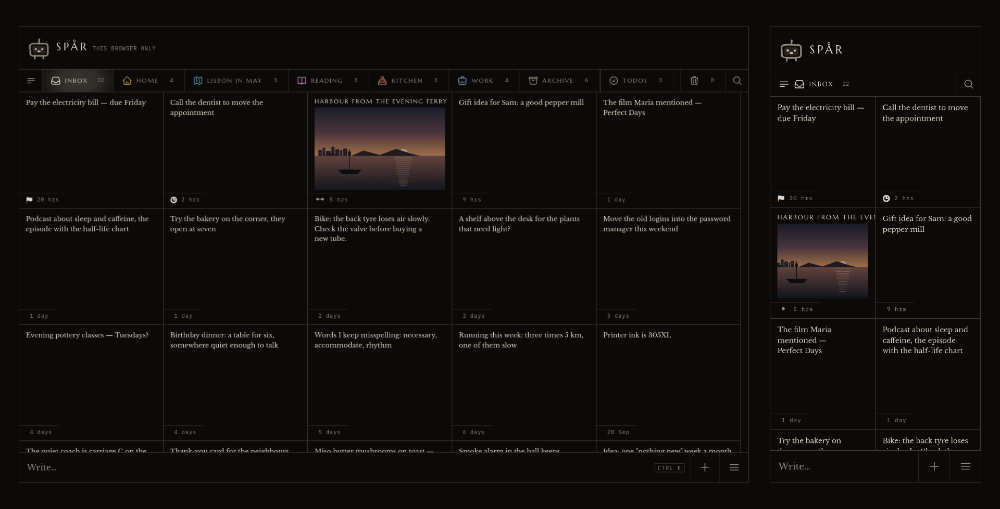
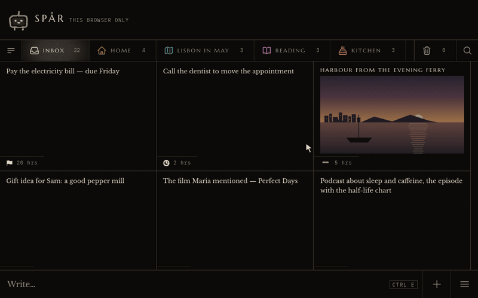
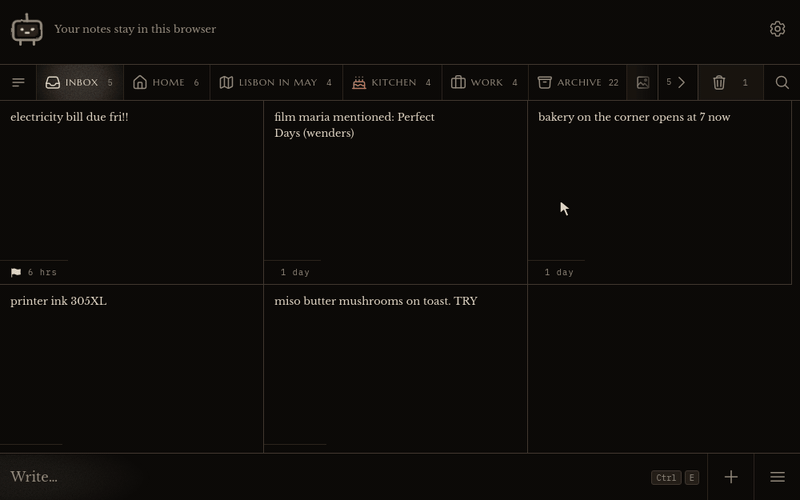
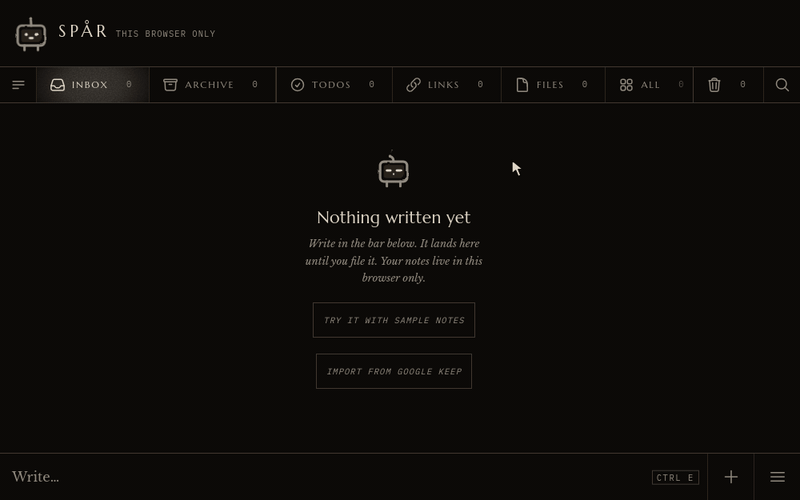
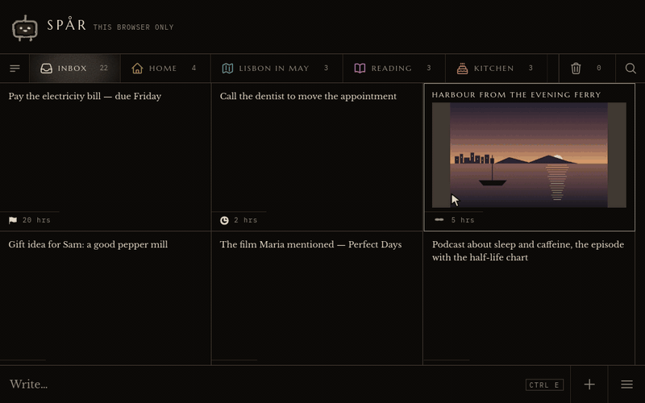
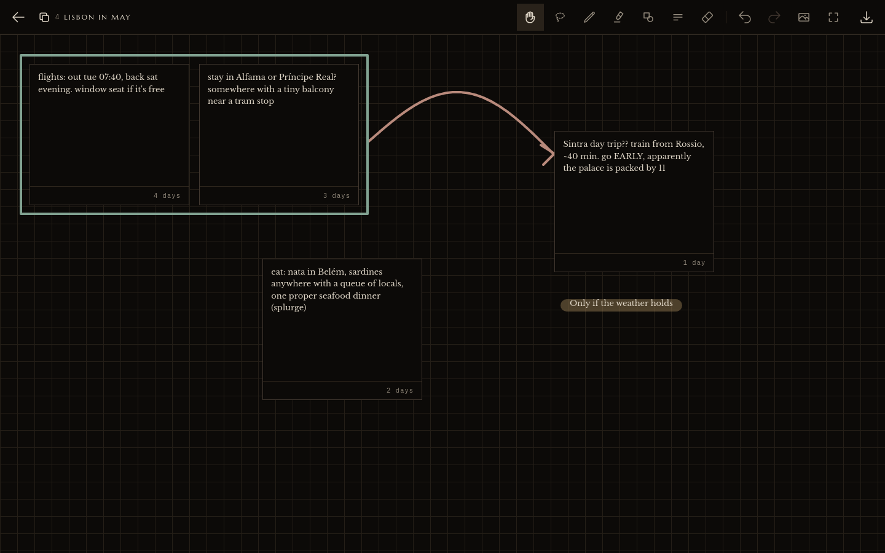

<p align="center">
  <a href="https://spar.willemaki.com">
    
  </a>
</p>

<h1 align="center">spår</h1>

<p align="center">
  A local-first Google Keep replacement.<br>
  Write it down now, with nothing to choose. Tidy the pile to zero later.
</p>

<p align="center">
  <a href="https://spar.willemaki.com"><b>Try the demo</b></a> ·
  <a href="#features"><b>Features</b></a> ·
  <a href="#run-it-with-docker"><b>Quick start</b></a> ·
  <a href="#coming-from-google-keep"><b>Import from Keep</b></a> ·
  <a href="docs/self-hosting.md"><b>Self-hosting</b></a>
</p>

<p align="center">
  <a href="LICENSE"></a>
  <a href="https://github.com/volccu/spar/releases"></a>
  <a href="https://spar.willemaki.com"></a>
  
  
</p>

<p align="center">
  <a href="https://spar.willemaki.com">
    <picture>
      <source media="(prefers-color-scheme: light)" srcset="docs/media/hero-light.png">
      
    </picture>
  </a>
</p>

spår (Swedish for *trace*) is a notes app for one person. It keeps Keep's model — short notes,
lists, links and pictures on cards — and replaces the interface: nothing to decide when you write
something down, and a quick way to put it all away afterwards. It runs in the browser and installs
as an app. It works with no server at all; add one when you want your notes on more than one device.

- **Capture asks for nothing.** One field at the bottom of the screen. Type, press Enter, and the
  note is on the board. No title, no folder, no label to pick first. Four optional marks wait
  beside Save for when you do want one.
- **Tidy the pile to zero.** Everything you write lands in the Inbox. When you have a minute,
  *Tidy up* shows one note at a time with your folders as buttons, and the Inbox counts down to zero.
- **Reminders that repeat, free.** Once, or every day, week or month, set on the note itself and
  rung by Web Push from your own server. There is no paid tier to put them behind.
- **Offline, no account, no AI.** The app opens from your device and works without a network. Used
  on one device it needs no account and no server. Nothing reads your notes to summarise, tag or
  "enrich" them: there is no model call anywhere in the code.

## See it

**Capture.** Type, press Enter, and it is there, before any server has heard about it.



**Tidy up.** One note at a time: move it to a folder, archive it, or delete it, until the pile is gone.



**Import from Google Keep.** A Takeout zip, read on your device. Labels can become folders; the rest lands in the Inbox.



**Merge, and separate.** Two notes become one idea with a canvas. Separate puts both back where they were.



**The canvas.** An idea's notes laid out by hand with a photo dropped beside them, then drawn on: a box and a ring from the shape tool, a pen arrow, words with a highlight across them, and a tram built from shapes.



Everything in these pictures is the demo's invented sample notes, and you can try it all in the
[demo](https://spar.willemaki.com). `npm run shots` makes the pictures again.

## Run it with Docker

One container holds the app and a small sync server with its SQLite database. Everything it keeps
is in one volume.

```bash
git clone https://github.com/volccu/spar.git && cd spar
docker build -t spar .
docker run -d --name spar --restart unless-stopped \
  -p 127.0.0.1:8080:8080 \
  -v spar-data:/data \
  -e SPAR_ALLOWED_HOSTS=localhost \
  spar
```

Open <http://localhost:8080> and make the first account; it becomes the admin. You build the image
yourself (there is no ready-made one to download); it is built on the machine that runs it, so a
Raspberry Pi 4 or 5 works.

The port is on loopback on purpose. Browsers allow a service worker (offline, installing, sharing
into the app) and Web Push (reminders) only over HTTPS or on `localhost`, so to use spår from a
phone, put an HTTPS reverse proxy such as Caddy in front of it. [`docs/self-hosting.md`](docs/self-hosting.md)
covers that, the first account, sign-up settings, backups and upgrades.

## Features

Everything spår does today, grouped by what you would be doing. Open a group to see all of it.
A few things need the installed app, and say so. The demo does everything except what needs a
server: sync, reminders that ring, and link previews.

<details>
<summary><b>Capture</b>: one field, Enter, done</summary>

- One growing text field at the bottom of every screen. No title box, no folder or label to pick.
- On a keyboard, Enter saves and Shift+Enter starts a new line. On a phone, Save is the button.
- Four optional marks beside Save: Important, To-do, a folder, a reminder. All start off, and ignoring them is the fast path.
- Written while you stand in a folder, a note is filed there; on Todos, it is a to-do. Anywhere else it lands in the Inbox.
- Attach any file from the bar, drop it on the window, or paste it with Ctrl+V.
- Start a sketch from the bar's add menu.
- Typing an address you saved before says so on the spot: "Saved 3 days ago · Open".
- When a note lands somewhere off screen, the robot says where, with a Go to jump there.
- Three bits of typing help and no more: `- ` becomes a dash, `[] ` becomes a tick box, Enter continues a list.
- What you first wrote is kept forever, whatever you edit later.

</details>

<details>
<summary><b>The open note</b>: read first, edit on touch</summary>

- A note opens for reading, and a touch puts you in the words. Every web address in it is a live link.
- Formatting is plain text that stays visible: `# ` heading, `**bold**`, `*italic*`, backticks for code. A `# ` first line names the note.
- An Insert menu adds a code block, today's date, a tick box or an attachment.
- Code blocks show in a fixed-width face with a Copy button.
- Tick boxes tick with a tap. List items drag by a grip in the margin, and numbered lists renumber.
- **Untick all** and **Clear done** appear while anything is ticked.
- Pick some words and make them a new note. One undo puts both halves back.
- Copy, Share (where the device has a share sheet) and Read aloud in your device's own voice.
- A right-click opens the note's own menu at the pointer.
- A note opens at the first search hit, and a long note at the place you left it.
- Edited on two devices at once? A notice offers to keep yours, show the newer one, or copy yours aside.

</details>

<details>
<summary><b>Boards and folders</b>: an Inbox to empty, folders like real folders</summary>

- The app opens on the **Inbox**: everything not yet filed. Its count is the one meant to reach zero.
- Folders are real places. A note is in at most one, like a file.
- Make, rename and delete folders. Deleting one archives its notes, so nothing is lost.
- Give a folder its own mark (about 1,850 icons, found by name) and one of sixteen muted tints. That is the only colour in the app.
- A folder can keep the screen awake while its notes are open, for a recipe or a packing list.
- **Todos**, **Links**, **Files** and **All** gather notes from every folder without moving them.
- A note that is nothing but links waits on Links, out of the Inbox, until you file or flag it.
- On a desktop every board sits in one strip, one click away. On a phone they are a drawer from the edge, and you swipe sideways between boards.
- Hold a board and carry it to reorder the shelf. Hide any built-in board but the Inbox in Settings.
- On a phone the board row can stand at the bottom, near your thumb.
- Each board remembers where you scrolled. Picking the board you are on goes back to the top.
- Pick several notes (long press, right-click, Ctrl or Shift+click, or Space) to copy, flag, merge, delete, archive or move them.
- Carry a held note onto a board to move it there, onto Archive or Trash to put it away, or onto another note to merge the two.
- Cards sit in a flush grid, each drawn for what it holds: text, a checklist with its done count, a link with its picture, a photo, a PDF's first page.
- Important notes rise to the top of their board, marked with a flag.
- Move has a type-to-find field, and makes a new folder from whatever you type.
- On first open with a big pile already there, one question: tidy it now, or leave it. Neither answer moves a note.

</details>

<details>
<summary><b>Tidy up</b>: one note at a time, your folders as buttons</summary>

- One note at a time, with every folder as a one-tap button, plus New folder, Archive and Delete.
- Offered from the menu on every board with notes ("Tidy up 34 notes").
- Swipe right to leave a note where it is, left to delete it. The note follows your finger.
- Keys 1–9 pick a folder, E archives, and the arrows leave a note or go back.
- Beside the note: Open, Important, To-do and Remind. Tap the words to fix a typo in place.
- Back, then Leave, undoes an earlier answer. The end is a plain report, and offers the run's deletes back in one go.

</details>

<details>
<summary><b>Todos and Tick off</b>: lists you actually finish</summary>

- A to-do is any note you mark as one, or any note made of two or more tick boxes.
- Short to-dos show as compact slips, so more fit on the screen.
- **Tick off** shows one list at a time with every box a big button.
- Ticked items sink below the open ones. **Untick all** resets a weekly shopping list, and **Archive** finishes one.
- The screen stays awake while you tick.

</details>

<details>
<summary><b>Merge and ideas</b>: related notes become one card</summary>

- Merge two or more notes into an **idea**: one card holding them all, with a canvas to lay them out on.
- The originals are archived, never deleted. **Separate** puts them all back where they were.
- Merge more notes into an idea later, or take one out on its own.
- **Dissolve** sends an idea to the Trash and leaves its notes alone.

</details>

<details>
<summary><b>Sketch canvas</b>: arrange, draw and write on an idea</summary>

- Drag an idea's notes and pictures wherever you want them.
- Pen, highlighter, shapes (rectangle, ellipse, line, arrow, with optional fill), text and an eraser.
- Pens in the app's three greys and the sixteen folder tints, in three widths. Hold Shift for a square, a circle or a straight line.
- Draw a rough box or ring and hold still, and the pen tidies it. One undo gives the rough line back.
- Select with a loop (finger) or a box (mouse) to move, resize, recolour, copy or delete.
- Paste, drop or add pictures onto the canvas.
- Undo and redo, zoom, "show everything", and a middle-button pan with a mouse.
- **Save as picture** makes a PNG of the whole canvas.
- Start a blank sketch from the capture bar. An empty one you back out of tidies itself away.

</details>

<details>
<summary><b>Inspiration</b>: a wall of pictures to look at again</summary>

- A built-in board drawn as a wall of pictures and links to pictures, each at its own shape.
- It opens into a full-screen viewer you swipe through. Videos from YouTube and Vimeo play in place.
- File into it like any folder, write while you stand on it, or take the one-tap offer when you share a picture into spår.
- A folder you already have called "inspo" or "inspiration" becomes the wall, notes and all.

</details>

<details>
<summary><b>Links</b>: saved pages with their pictures</summary>

- Link previews show the page's title and picture, fetched by your own server, never by your browser. They can be switched off.
- The Links board shows each page's picture: rows on a phone, tiles on a desktop.
- Hide a preview with its ✕, and undo brings it back. The address in your text is never touched.
- Pages that have disappeared are marked **gone**. Saved links are re-checked monthly, a few at a time.
- A bookmarklet in Settings saves the page you are reading from your browser.

</details>

<details>
<summary><b>Files, pictures and PDFs</b>: any file, up to 50 MB</summary>

- Attach any file up to 50 MB.
- A photo's or video's location data is removed on the way in. iPhone HEIC photos become JPEG, and very large photos are scaled to 2560 px.
- Cards show a thumbnail, and a PDF shows its first page.
- A full-screen picture viewer zooms, rotates, copies, sets a cover, downloads, removes, and walks through a note's files.
- PDFs are drawn inside the app. Audio and video files play.
- Removing a file always asks first. A file that exists only on this device is never cleared from its cache.

</details>

<details>
<summary><b>Search</b>: instant, over everything you kept</summary>

- Searches as you type, on the device, over every note including the Archive. The Trash stays out.
- Every word must match, and endings like plurals do not matter. "Quoted words" must appear together.
- Hits are highlighted, and a result opens at the first one.
- Finds words inside PDFs and inside pictures (screenshots, photos of signs), read on your device and never sent anywhere.
- One chip narrows a search to a folder, the Archive, Links or Inspiration.
- A search that finds nothing offers your recent searches, a near spelling, or the note's place in the Trash.

</details>

<details>
<summary><b>Reminders</b>: free, and they repeat</summary>

- Set from the capture bar or the open note: in 1 hour, tonight, tomorrow, next week, or any time you pick.
- Repeat every day, week or month.
- Rung by Web Push from your own server. Notification permission is asked only when you set one.
- A one-off reminder's notification has **Later** (an hour on) and **Done**.
- A Reminders list in the menu shows everything coming up, soonest first.
- The robot gives you a heads-up five minutes before.
- A device that cannot ring says so on the note, instead of failing quietly.

</details>

<details>
<summary><b>Sync and offline</b>: your device first, the server second</summary>

- Opens from your device and works with no network. Every change is saved on the device first, in under 50 ms.
- Changes queue while offline and go up when the network returns, retried until the server has them.
- Changes made on your other devices arrive live.
- Two ways to sync: the spår server (one container) or your own Supabase project. Or none at all, on one device.
- "Use on this device only" is always offered, and notes made that way survive a later sign-in.
- Different accounts never mix on one device.
- The robot says sync trouble in words, and storage problems get a banner.
- New versions are offered, never forced on you.

</details>

<details>
<summary><b>Trash, archive and undo</b>: nothing is lost by accident</summary>

- Delete moves a note to the Trash for 30 days. **Put back** restores it.
- Only emptying the Trash by hand (which asks first) or the 30-day sweep removes a note for good.
- Archive keeps a note out of the way, and it stays searchable.
- Undo works for archive, delete, move, merge, split, import and more, with Ctrl+Z or the robot's Undo.
- The original words of every note are kept, and are in every download.

</details>

<details>
<summary><b>Import and export</b>: come in from Keep, leave whenever you like</summary>

- Import from Google Keep: the Takeout zip or folder, read in your browser and never uploaded to be read.
- It brings titles, checklists, links, pinned and archived notes, labels (as folders, or wherever you choose) and attachments, with Keep's own dates.
- Importing the same Takeout twice skips what is already here, and one undo takes a whole import back.
- **Download everything** saves a zip: each note a text file in a folder per place, its files beside it, and one JSON file of it all.
- A spår download can be imported back in, safely, as many times as you like.
- Closing your account deletes everything the server holds for it.

</details>

<details>
<summary><b>Install and share</b>: an app on your phone and desktop</summary>

- Installs as an app from the browser, on Android, desktop and iPhone.
- In Android's share sheet: share a page, some text or several photos into spår, and they become one note. *(installed app)*
- Long-press the icon, or right-click it on the taskbar, for **New note**. *(installed app)*
- An optional Inbox count on the app icon, where the system supports it.
- On iPhone and iPad it works in Safari, and reminders ring once it is on the Home Screen.

</details>

<details>
<summary><b>Settings and look</b>: dark by default, light if you like</summary>

- Theme: dark (the default), light, or follow the device.
- Motion follows your system, or asks for less on this device only.
- A short buzz on save and tick, where the phone supports it, which can be switched off.
- Switches for link previews, the robot's weather, tidy shapes and the app-icon count.
- Settings are searchable, and open with Ctrl+,.
- Settings shows how fast spår is on your device: capture, open, typing and search times.

</details>

<details>
<summary><b>Keyboard</b>: every common action has a key</summary>

- Ctrl+K search, Ctrl+E write, Ctrl+A select all, Ctrl+Z undo, Ctrl+, settings, Esc closes, and `?` lists every key.
- On cards: arrows walk the grid, Enter opens, E archives, M moves, F flags, Delete deletes, Space picks.
- In a note: Ctrl+B, Ctrl+I, and Ctrl+Enter to close.
- Tidy up takes 1–9 and E. The picture viewer takes arrows, zoom keys and R to rotate. The canvas takes undo, redo, duplicate and delete.
- On a touch screen, the About page lists the gestures instead.

</details>

<details>
<summary><b>The robot</b>: a small machine that is also the sync light</summary>

- It lives in the header and shows how sync stands. It sleeps late at night.
- It speaks in one small bubble: undo offers, where a note landed, how many you picked, a reminder coming up.
- Poke it for the weather (asked only after a tap, place rounded, can be switched off) or how sync stands. Double-tap it to sync now.
- It nods when you save, hops when a Tidy up is done, and holds up a sign at 100, 500 and every 1,000 notes.
- Drop a card on it to archive the card.

</details>

<details>
<summary><b>Privacy and self-hosting</b>: yours, on your terms</summary>

- No AI anywhere. No analytics, no error reporting, no calls home. The fonts are served with the app.
- On one device, nothing leaves it. With a server, the server is yours.
- Link previews and their pictures come through your server, so the sites you save never see your browser.
- Three ways to run it: one Docker container (the app plus a SQLite sync server), your own Supabase project, or one device only.
- Sign-up can be closed, by invite, or open, with an admin command line for users and invite codes.
- A public demo runs on invented sample notes, with no server at all.

</details>

**Not in spår**, on purpose or not yet: native apps and home-screen widgets, sharing a note with
someone else, end-to-end encryption, labels, and colours for notes.

## Coming from Google Keep

In Keep's Takeout (takeout.google.com, choose Keep), Google sends you a zip. In spår, open the menu,
choose **Import from Google Keep**, and pick the zip or the unzipped `Keep` folder. It is read in the
browser; nothing is uploaded to be read.

- Titles, text, checklists (as `[ ]` / `[x]` lines), saved links, and Keep's own created and edited
  times come across. Pinned notes are marked important. Archived notes go to the Archive; Keep's
  trash is left behind.
- Photographs, drawings and recordings become attached files (up to 50 MB each). Anything that could
  not come across is named in the summary, never dropped silently.
- Each label can become a new folder, go into a folder you have, or stay in the Inbox. A note lives
  in one folder, so the labels that did not become its folder are written on its last line
  (`Keep labels: work, ideas`).
- Keep's colours, its reminders (Takeout does not export them) and its sharing do not come across,
  and the import screen says so before you start.
- Importing the same Takeout again skips what is already here, and one undo sends the whole import
  to the trash.

Then *Tidy up* takes it from there.

## Principles

The long version, with the reasons, is in [`SPEC.md`](SPEC.md) (what the app does) and
[`DESIGN.md`](DESIGN.md) (how it looks). The short one:

1. **Capture asks for nothing.** Writing something down costs exactly one field and Enter.
2. **Organising is optional, after the fact, and one gesture.** Never required, never a menu dive.
3. **The original capture is always recoverable.** Edits never overwrite what you first wrote.
4. **Nothing is destroyed by accident.** Delete means the Trash; only the 30-day sweep or emptying
   the Trash by hand, which asks first, removes a note for good.
5. **A note needs no metadata to work.** Every field beyond the text is yours to set or leave.
6. **The everyday path is instant.** Open, capture, edit and find commit locally in under 50 ms,
   with no spinner. Settings shows how fast it was on your device.
7. **Everything can leave.** One download holds the whole archive in plain files.

And one about looks: **there is no colour, and dark is the ground.** The app is a warm greyscale
on a dark ground, so the brightest thing on the screen is always what you wrote. The only exceptions
are ones you choose: the tint of a folder you made, and the colour of a pen on a sketch. Settings offers a light version of the same greys, or one that follows the device;
out of the box spår is dark.

## Alternatives

spår is small and opinionated, and there are good open-source notes apps that suit other people
better. What each one does better, as far as its own documentation says:

- **[Kept](https://github.com/ericerkz/kept)** is a faithful self-hosted copy of Google Keep: labels,
  colours, drawings, pinned notes, link previews, Takeout import, repeating reminders by browser
  push, and sharing a note with other people on the same server. It has native iOS and Android apps
  with a widget, a share-sheet capture and location reminders. **Choose it** if Keep's interface
  suited you and you only want it on your own server, or you need native apps or shared notes.
- **[Memos](https://github.com/usememos/memos)** is a timeline of Markdown notes with tags, run with
  one `docker run` on SQLite, PostgreSQL or MySQL. It has a REST and gRPC API, public sharing, a web
  clipper and a large community. **Choose it** if you think in a stream rather than in cards, want to
  publish some notes, or want to script against your notes.
- **[Unforget](https://github.com/computing-den/unforget)** is the closest in shape: a local-first
  web app with Google Keep import. It encrypts notes end to end, so its server only ever holds
  ciphertext, and it offers a free hosted sync. It has no reminders. **Choose it** if you want sync
  through a server that cannot read your notes.
- **[Joplin](https://joplinapp.org)** is a Markdown notebook app with native apps on every desktop
  and phone platform, end-to-end encrypted sync through many targets (Nextcloud, WebDAV, S3, its own
  server and others), plugins and a web clipper. Keep import is by a community plugin. **Choose it**
  for long, structured notes, notebooks, and a mature ecosystem.
- **[Notesnook](https://notesnook.com)** encrypts everything end to end and has polished native
  apps on every platform, a rich editor and a thorough on-device Keep import. Its sync server can be
  self-hosted but is still described as alpha, and repeating reminders are on its paid plans.
  **Choose it** for encryption with native apps and a hosted service run by a company.

What spår has that they do not all have: capture that asks nothing, an Inbox you are meant to empty
with Tidy up, merge and separate with a canvas, free repeating reminders, search inside PDFs, and no
AI features planned or present. What it lacks, plainly: end-to-end encryption, native apps, widgets
and sharing.

## On iPhone and iPad

spår works in Safari, but reminders only ring once it is on the Home Screen: iOS allows Web Push
only for web apps added there (iOS 16.4 and later). Open spår in Safari, tap Share, then
**Add to Home Screen** (on iOS 26, leave *Open as Web App* on), open it from the new icon, and allow
notifications when you first set a reminder. [`docs/ios.md`](docs/ios.md) has the steps, what to do when notifications do not arrive,
and what is known about the EU.

## Privacy

- **On one device, nothing leaves it.** Without a server your notes are in the browser's storage
  and nowhere else. The public demo works this way: its address hands out the app and receives
  nothing back, not your notes and not what you type. Clearing the site's data deletes the notes,
  so use *Download everything* to keep a copy.
- **With a server, the server is yours.** The spår server stores your notes, files, folders,
  reminder times and push subscriptions, and your email address with a scrypt hash of your
  password. Notes are not encrypted at rest beyond what your disk does, so whoever runs the server
  can read them. With your own Supabase project, the same data lives there instead.
- **Link previews are fetched by your server** (or your Supabase project's function), not by the
  browser, so the site you linked sees your server's address, and the preview's picture is stored
  with the note rather than loaded from that site. Reminders travel through the push service your
  browser uses (Google's, Mozilla's or Apple's); Web Push encrypts the message, so that service sees
  when a notification was sent, not what it says.
- **No telemetry.** There are no analytics, no error reporting and no calls home. The fonts are
  served with the app. spår times its own capture, open, typing and search on your device and shows
  the medians in Settings; the timings are never stored or sent.

## Self-hosting

There are three ways to run spår, all described in [`docs/self-hosting.md`](docs/self-hosting.md):

1. **One container** (the default): the app and the spår server, with SQLite, in one image and
   one volume.
2. **Your own Supabase project**: the same image serves the app and points it at your project;
   `npm run supabase:setup` prepares the project.
3. **One device only**: the static app with no backend, served from any web server, or the image
   with `SPAR_BACKEND=none`. The public demo is this build; see [`docs/demo.md`](docs/demo.md).

## Development

spår is Vite, React and TypeScript in the browser, IndexedDB on the device, and a Node server with
SQLite (or Supabase) for sync. You need Node 22. Run every command from the repository root; the
root scripts reach into `web/` for you.

```bash
npm ci && npm --prefix web ci   # once
npm run dev                     # the app, device-only unless web/.env names a backend
```

With no `web/.env` the app runs on the device only, which is all most changes need. To work on
sync, run the spår server from source as [`docs/self-hosting.md`](docs/self-hosting.md#running-the-server-from-source)
describes.

Every change passes the same checks CI runs:

```bash
npm run lint                    # eslint over the repository, then the server's and the root's typechecks
npm test                        # the root suite
npm run build:web               # the app's typecheck, then the production build
npm run test:web                # the app's suite
npm run test:server             # the spår server's suite
npm run test:conformance:server # the sync contract, run against the spår server
npm run e2e:server              # two headless Chrome profiles against a real server (needs Docker)
```

Neither test suite checks types, so `npm run build:web` (the app) and `npm run lint` (the server,
and `src/`, `tests/` and `conformance/`) are the only places a type error shows. To run one test file:

```bash
npm test -- tests/keep.test.ts                    # the root suite
npm --prefix web test -- src/lib/face.test.ts     # the app's suite
```

[`CONTRIBUTING.md`](CONTRIBUTING.md) explains what each one covers and how a pull request reaches a
release. `npm run shots` rebuilds the pictures in this README from the demo's sample notes
(it needs Docker). Security reports go to [`SECURITY.md`](SECURITY.md); changes are listed in
[`CHANGELOG.md`](CHANGELOG.md).

### Where things are

```text
web/                    the app: everything that runs in the browser
  src/App.tsx           the screen: boards, the open note, the modes, Back and Escape
  src/components/       one file per piece of the screen (NoteCard, NoteView, CaptureBar, Sorter…)
  src/lib/              logic with no storage in it, and the small hooks App.tsx is built from
  src/store/            the device's database (IndexedDB), sync and its outbox, accounts, undo
  src/store/backend/    the two sync targets behind one interface: the spår server and Supabase
  src/styles.css        every visual value, as tokens; styles.test.ts holds the design rules
  public/               icons, fonts, the manifest, and the service-worker parts for push and share
  e2e/                  browser checks (Playwright) against the demo build
server/                 the spår sync server: Node and SQLite, accounts, files, link previews, push
supabase/               the other backend: Postgres migrations and two edge functions
conformance/            the sync contract as tests, run against either backend
src/, tests/            the original command-line Google Keep importer and its suite
scripts/                project setup, migration checks, screenshots, the end-to-end server run
docs/                   self-hosting, the sync contract, the server API, database migrations
```

Most tests sit beside the file they test (`face.ts` and `face.test.ts`). The app-wide ones are
`web/src/App.*.test.tsx`, one file per behaviour.

### Decisions that shape the code

These are settled. [`SPEC.md`](SPEC.md) gives the reasons, and a change that keeps them is much
easier to take than one that argues with them.

- **The device is the source of truth.** The app reads and writes IndexedDB and never waits for
  the network. Changes go into an outbox that is sent in the background and retried until the
  server takes them.
- **Last write wins, field by field.** No CRDTs (merge-anything data structures) and no block
  model: one person on a few devices seldom edits the same field in two places at once.
  [`docs/sync-contract.md`](docs/sync-contract.md) is the exact rule, and `conformance/` tests it.
- **Two backends, one contract.** The app talks to sync through one interface (`Backend`, in
  `web/src/store/backend/types.ts`) with two implementations, and the conformance suite runs the
  same tests against both.
- **What you first wrote is never changed.** `raw_content` is set once, and both backends refuse
  any change to it. Every edit goes to `body`.
- **Delete moves to the Trash.** Only the 30-day sweep and emptying the Trash by hand (which asks
  first) destroy a note.
- **A folder is a real place.** A note is in at most one, like a file. Todos, Links, Files and All
  are views across every folder; nothing is ever filed into them.
- **No AI.** Summaries, tags and semantic search were tried early and removed (`SPEC.md` §8).
- **The look is enforced by tests.** [`DESIGN.md`](DESIGN.md) decides how things look, and
  `styles.test.ts` fails the build on a raw colour, size, font or timing outside the tokens.

## Licence

spår is released under the [GNU Affero General Public License v3.0](LICENSE). There is no
contributor agreement. The three typefaces it ships, Libre Baskerville, Marcellus and IBM Plex
Mono, are under the SIL Open Font License 1.1 ([`web/public/fonts/OFL.txt`](web/public/fonts/OFL.txt)).
